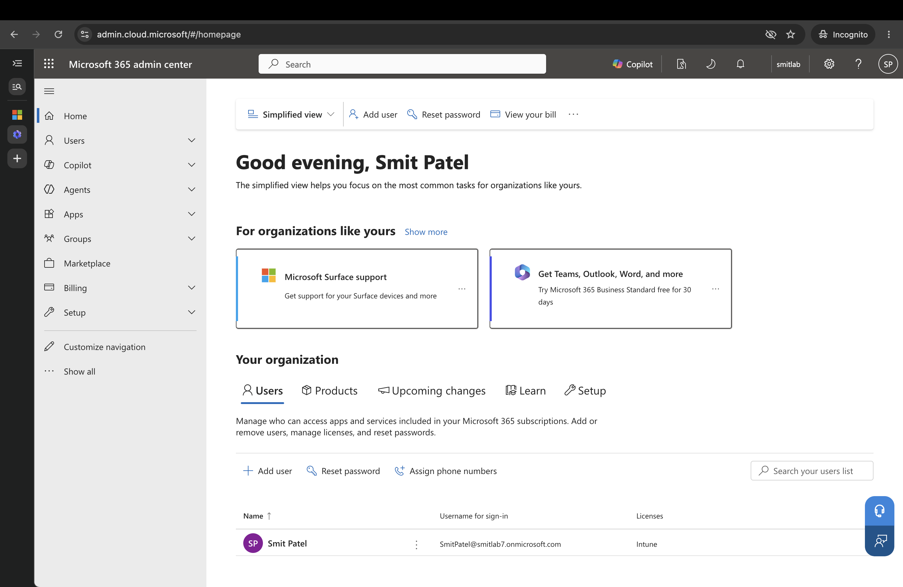
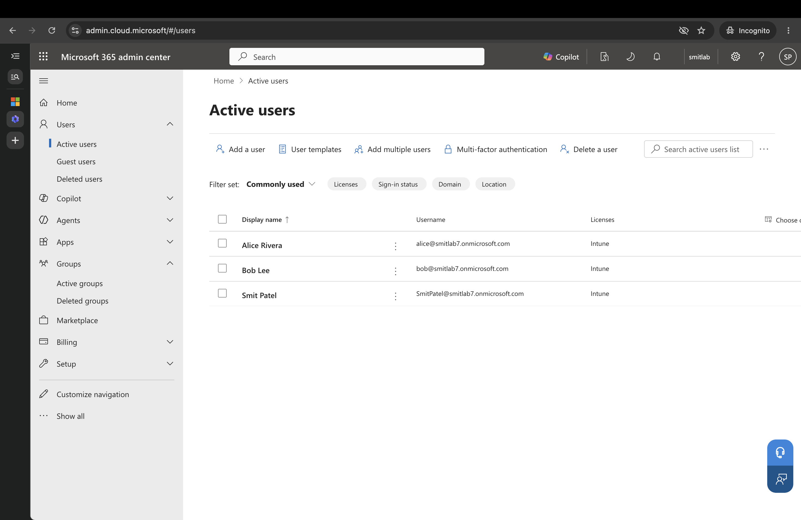
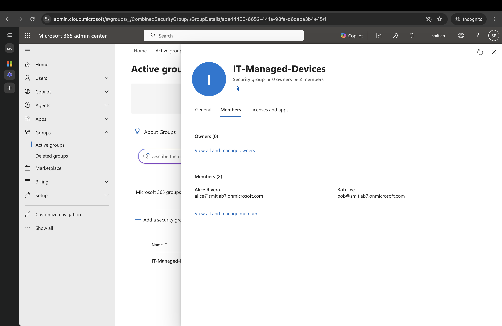
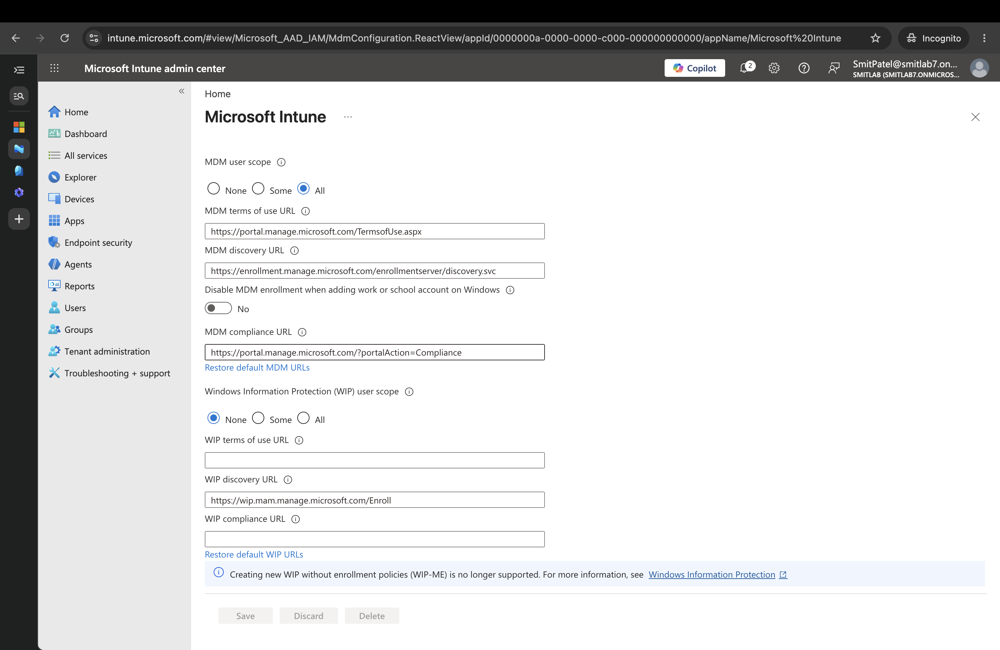
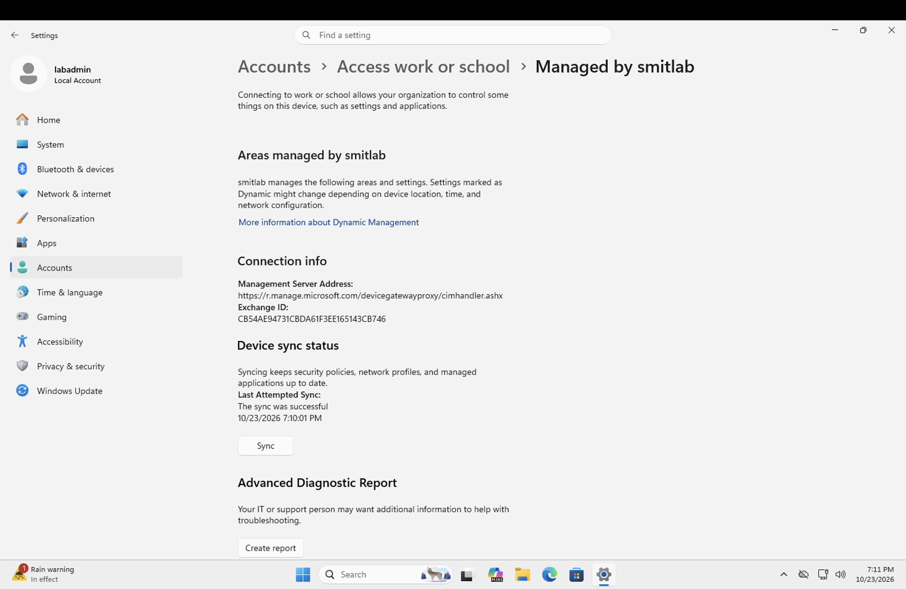
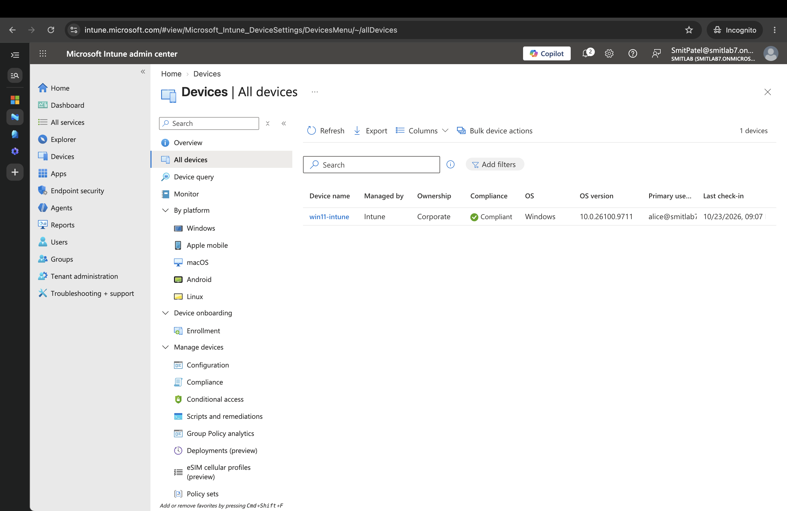

# Enrollment Walkthrough

How the `win11-intune` VM went from a blank Azure VM to an Entra ID joined, Intune-managed device.

## 1. Tenant, users, and group

I signed up for the Microsoft Intune free trial as a new account. This creates a separate tenant (`smitlab7.onmicrosoft.com`), independent of the tenant behind my Azure subscription. The signup required a payment card for identity verification; nothing is charged unless a paid subscription is purchased.

In the Microsoft 365 admin center I created two test users (Alice Rivera and Bob Lee), assigned both an Intune license, and created a security group, `IT-Managed-Devices`, containing both.





## 2. Entra ID P2 license

Automatic MDM enrollment requires Entra ID Premium (P1 or P2). The Intune trial alone does not include it, so I activated the Entra ID P2 trial and assigned it to the test users. I turned recurring billing off on both trials so they expire on 11/24/2026 instead of converting to paid subscriptions.

## 3. Automatic enrollment

In the Intune admin center (Devices > Enrollment > Windows > Automatic Enrollment) I set **MDM user scope** to **All**. Any user in the tenant who joins a Windows device to Entra ID now has that device enrolled in Intune automatically.



## 4. The VM

I created `win11-intune` with the Azure CLI:

- Windows 11 Enterprise 24H2 (`win11-24h2-ent`)
- Size `Standard_B2as_v2`, Belgium Central, Standard HDD disk to keep idle cost down

The VM landed in the same VNet as the Active Directory lab, and that VNet's DNS points at DC01 (Lab 1). With DC01 powered off, the VM could not resolve Microsoft's login endpoints. I overrode DNS on this VM's network interface only, so the two labs stay independent:

```
az network nic update -g rg-homelab -n win11-intuneVMNic --dns-servers 8.8.8.8
```

Before joining, I verified from inside the VM:

- `nslookup login.microsoftonline.com` resolved
- `Test-NetConnection enterpriseregistration.windows.net -Port 443` returned `TcpTestSucceeded : True`
- `dsregcmd /status` showed `AzureAdJoined : NO` and `DomainJoined : NO` (clean baseline)

## 5. Joining the VM to Entra ID

Inside the VM (signed in as the local `labadmin` account):

1. Settings > Accounts > Access work or school > Connect
2. Selected **Join this device to Microsoft Entra ID** (the small link under the sign-in box), not the main sign-in field. The main field only _registers_ a work account on the device; the link _joins_ the device to the organization.
3. Signed in as `alice@smitlab7.onmicrosoft.com`, confirmed the `smitlab` organization, and restarted.

After the restart, Settings shows the device as **Managed by smitlab**, with the Intune management server address and a successful sync.



## 6. Result in Intune

The device appeared in Intune with Alice Rivera as primary user, ownership Corporate, managed by Intune.



## Notes

- The VM clock is Pacific time and the Intune portal is Central time, so the same event shows two hours apart across screenshots.
- `labadmin` is a local account and still works alongside the Entra accounts. Joining adds an identity source; it does not remove the local one.
- Enrollment makes Alice the primary user, but other users in the tenant can also sign in at the device.
