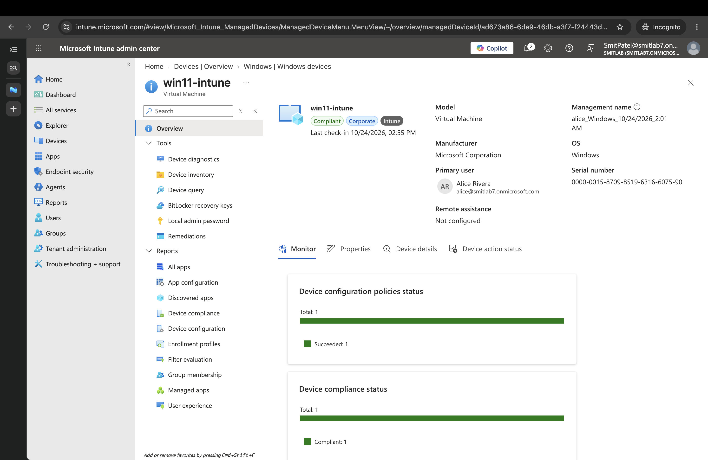
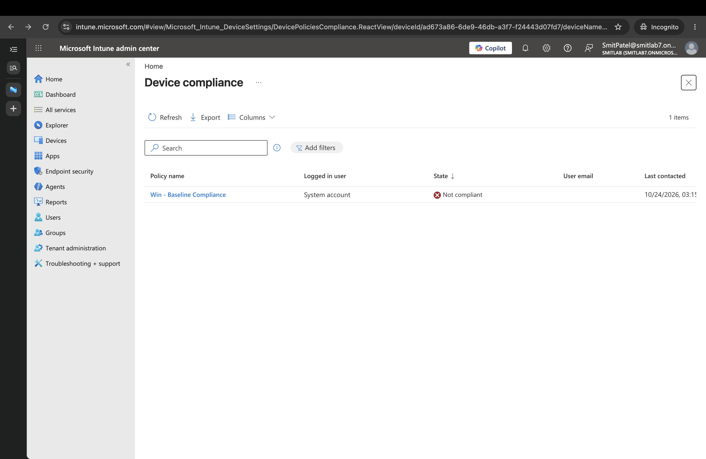
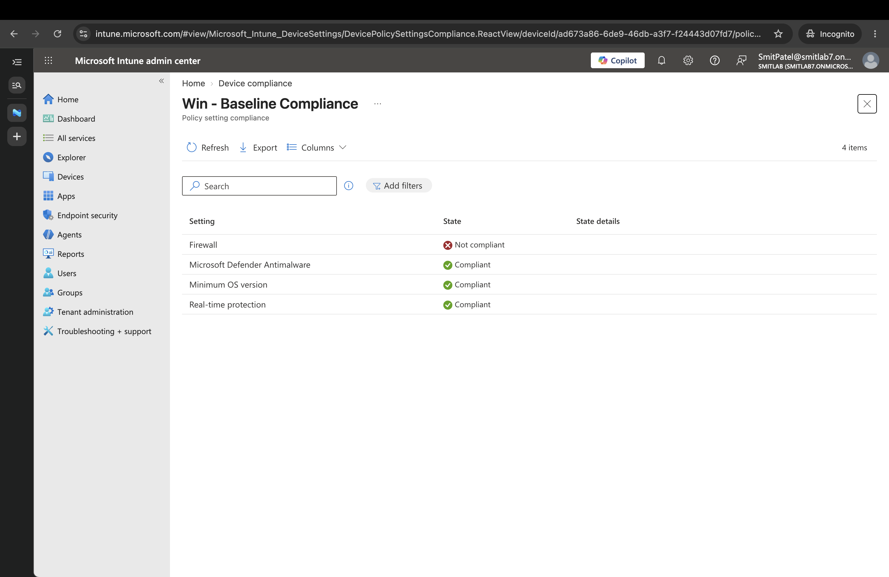
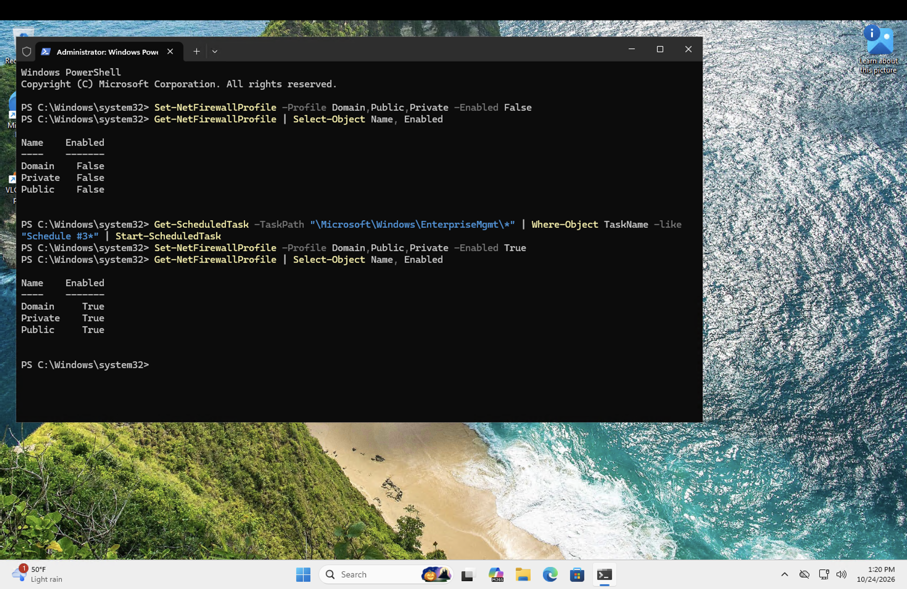
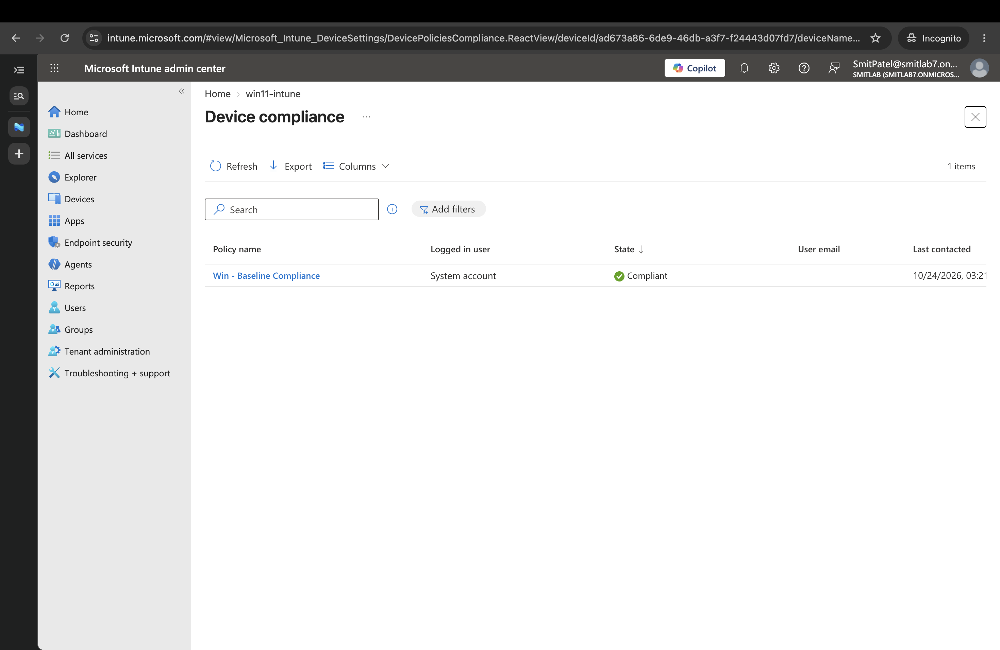

# Ticket: Device went noncompliant (firewall disabled)

I caused this one deliberately to confirm that Intune detects a security-rule violation and to practice the diagnose-and-recover workflow.

## Policy under test

`Win - Baseline Compliance` requires:

- Firewall on
- Microsoft Defender antimalware
- Real-time protection
- Minimum OS 10.0.22631.0

Noncompliance action: mark the device noncompliant immediately. No remediation action is configured.

## Baseline

Before changing anything, the device showed **Compliant**, and the compliance chart showed Total: 1, Compliant: 1. Last check-in was 2:55 PM.



## Break

On the VM, in an elevated PowerShell session, I disabled all three firewall profiles and forced an Intune check-in:

```
Set-NetFirewallProfile -Profile Domain,Public,Private -Enabled False
Get-NetFirewallProfile | Select-Object Name, Enabled
Get-ScheduledTask -TaskPath "\Microsoft\Windows\EnterpriseMgmt\*" | Where-Object TaskName -like "Schedule #3*" | Start-ScheduledTask
```

All three profiles reported `Enabled: False`.

## Detection

About a minute after the check-in, the policy state changed to **Not compliant** (last contacted 3:15 PM).



Opening the policy shows the per-setting result. Only **Firewall** failed. Defender, real-time protection and minimum OS version still passed.



This is the helpdesk workflow: from "the device is red" to the specific failing setting in two clicks, without touching the device.

## Fix

Compliance policies only check state; they never change it. Nothing re-enabled the firewall, so the fix was made on the device:

```
Set-NetFirewallProfile -Profile Domain,Public,Private -Enabled True
Get-NetFirewallProfile | Select-Object Name, Enabled
```

All three profiles reported `Enabled: True`. The PowerShell session, including both the disable and re-enable, is below.



## Verification

After the firewall was re-enabled and the device re-evaluated, `Win - Baseline Compliance` returned to **Compliant** (last contacted 3:21 PM).



## Timeline

Portal times are Central; the PowerShell screenshot clock is Pacific (two hours earlier for the same moment).

| Time (Central) | Event                                          |
| -------------- | ---------------------------------------------- |
| 2:55 PM        | Baseline: Compliant                            |
| ~3:14 PM       | Firewall disabled, check-in forced             |
| 3:15 PM        | Not compliant; Firewall is the failing setting |
| 3:21 PM        | Firewall re-enabled; Compliant                 |

## Lessons

- A compliance policy detects problems but does not fix them. Fixing requires a person, a remediation script, or a configuration profile that enforces the setting.
- The per-setting view in the policy report is the fastest way to find the cause of a noncompliant device.
- In production, noncompliance is usually paired with Conditional Access, so a noncompliant device is blocked from company resources until fixed. I did not configure Conditional Access in this lab.
- In production, a noncompliance action such as an email to the user would also be configured, so the user hears about it without a ticket.
