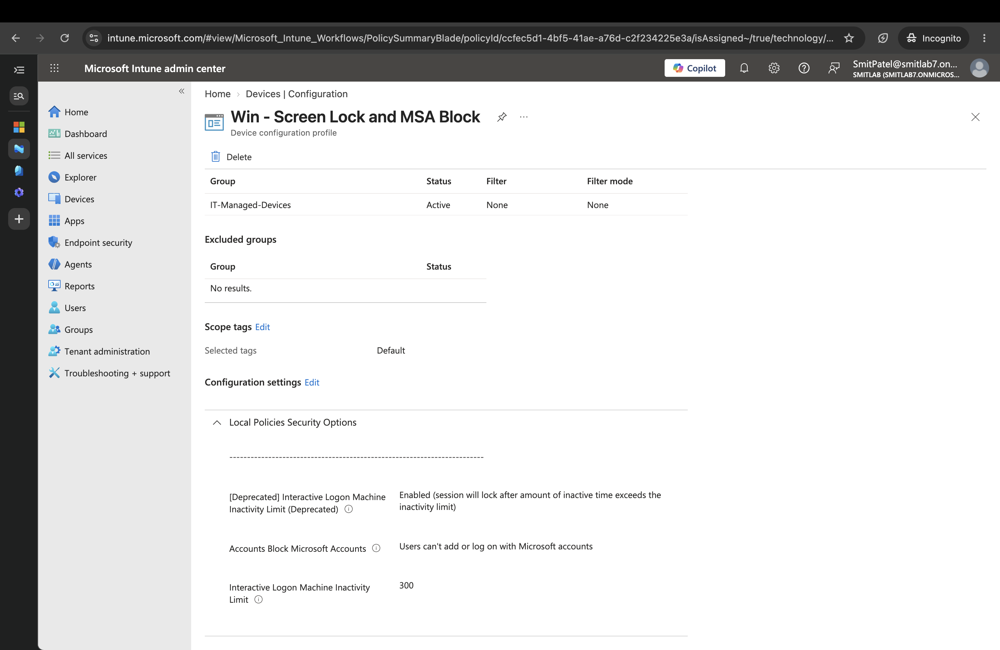
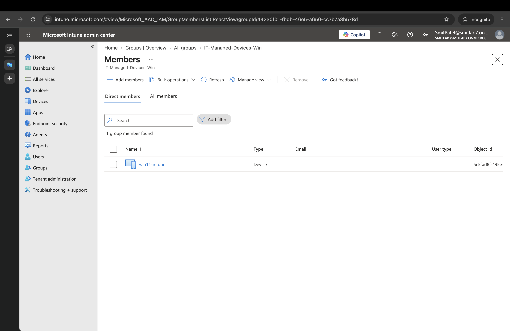
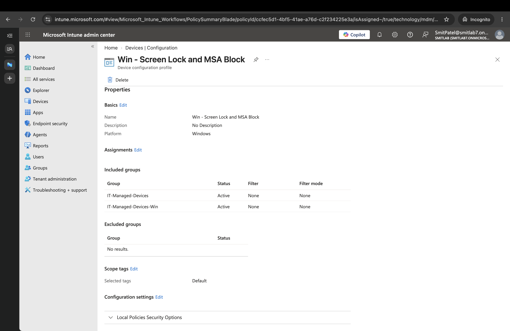
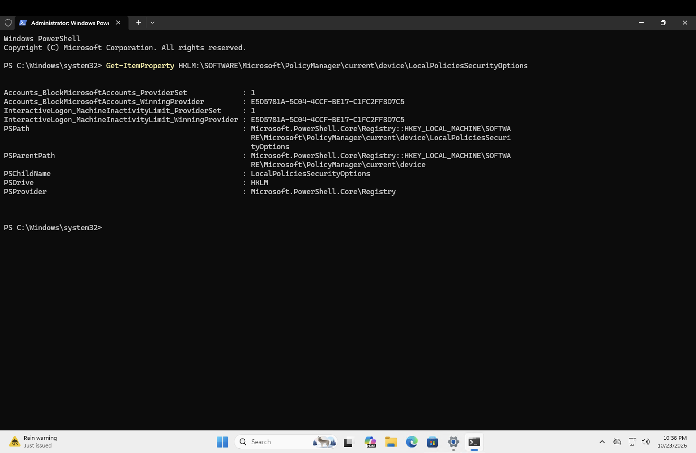
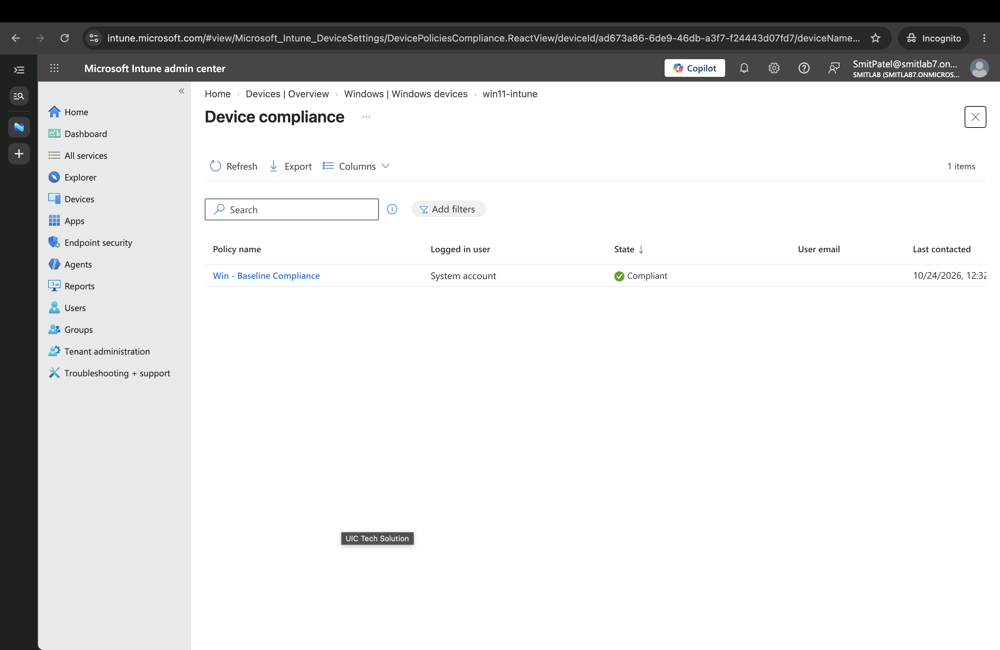
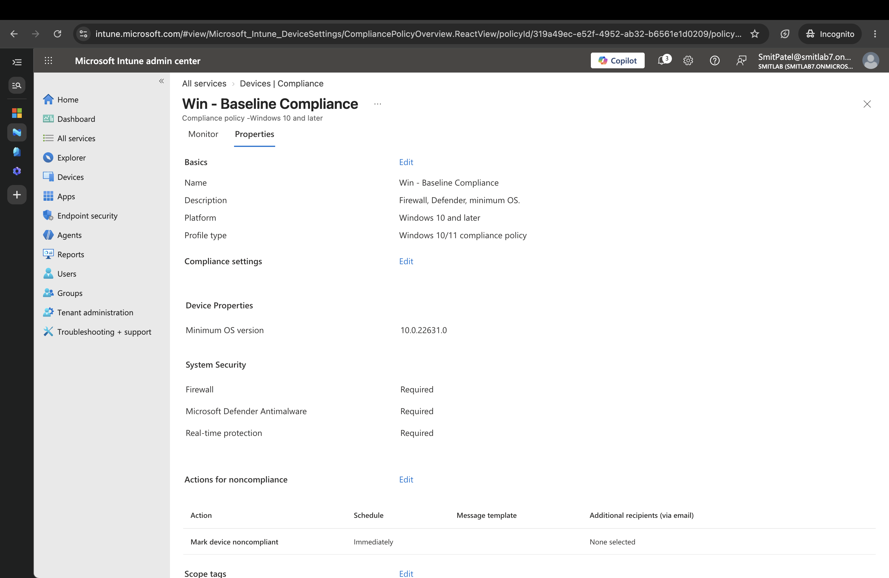

# Ticket: Policies assigned but not applying to the device

## Symptom

After creating a compliance policy and a configuration profile and syncing the device:

- The device showed a green **Compliant** badge in Intune.
- Devices > win11-intune > Device compliance said **No device compliance found**.
- The device page said **No device configuration policies**.
- On the VM, the registry values the profile should set did not exist:

```
> reg query HKLM\SOFTWARE\Microsoft\Windows\CurrentVersion\Policies\System /v InactivityTimeoutSecs
ERROR: The system was unable to find the specified registry key or value.
> reg query HKLM\SOFTWARE\Microsoft\Windows\CurrentVersion\Policies\System /v NoConnectedUser
ERROR: The system was unable to find the specified registry key or value.
```

- Settings still offered options the profile was supposed to block.

## Initial assumption (wrong)

The green Compliant badge meant the compliance policy had been evaluated and passed.

## Investigation

1. **Assignments.** Both policies were assigned only to `IT-Managed-Devices`, a group of _users_ (Alice and Bob).

   

2. **Who was signed in.** Alice only _joined_ the device. Every session since had been `labadmin`, a local account that Intune knows nothing about.
3. **The badge.** Intune marks a device Compliant by default when no compliance policy has been evaluated against it. The green badge was the default, not a result.

## Cause

The policies were targeted at users, and no targeted user had signed in on the device, so nothing was delivered. I did not isolate this by signing in as Alice with only the user assignment in place; the diagnosis is supported by the fix below working.

## Fix

Screen lock and Microsoft account blocking are device-wide settings, so I targeted the device itself:

1. Created a device security group, `IT-Managed-Devices-Win`, with `win11-intune` as a member.

   

2. Added that group to both the compliance policy and the configuration profile, keeping the user group assigned too.

   

3. Forced a sync from the VM.

## Verification, layer by layer

| Layer         | Question                          | Result                                                                    |
| ------------- | --------------------------------- | ------------------------------------------------------------------------- |
| Targeting     | Is the device in scope?           | Yes, device group assigned                                                |
| Communication | Is the device checking in?        | Last check-in 12:32 AM, after the assignment                              |
| Delivery      | Did the setting reach the device? | PolicyManager shows `ProviderSet : 1` with Intune as the winning provider |
| Application   | Did Windows apply it?             | `InactivityTimeoutSecs = 0x12c` (300), `NoConnectedUser = 0x3`            |
| Reporting     | Does the console agree?           | Lagged behind the device; caught up later                                 |



```
> reg query ...\Policies\System /v InactivityTimeoutSecs
    InactivityTimeoutSecs    REG_DWORD    0x12c
> reg query ...\Policies\System /v NoConnectedUser
    NoConnectedUser    REG_DWORD    0x3
```

The compliance policy then appeared in the device's compliance list with a real evaluation.





## Lessons

- **Target device-wide settings at device groups.** A user assignment only lands when that user is signed in.
- **Don't trust the Compliant badge alone.** Open the policy list and confirm a policy was actually evaluated.
- **The portal reports last.** Verify on the device (PolicyManager, then the registry) before concluding a policy failed.
- **Production hardening:** set "Mark devices with no compliance policy assigned as" to **Not compliant**, so a device with no policy can't look healthy.

## Related

Same pattern as Lab 1: a policy can be correct and still not apply because it targets a different context (user vs. computer) than the one being checked. See the `gpresult` investigation in `active-directory/group-policy.md`.
